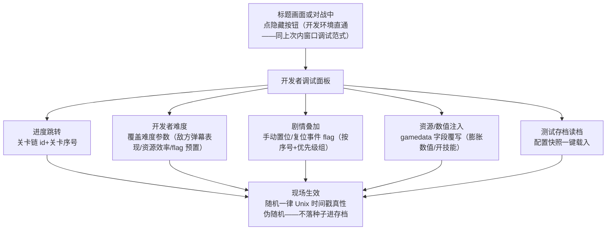
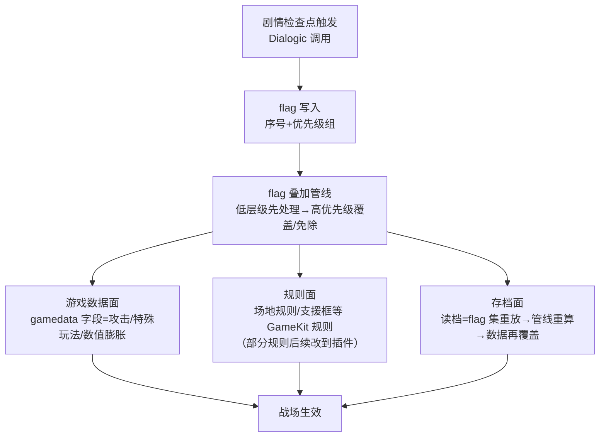
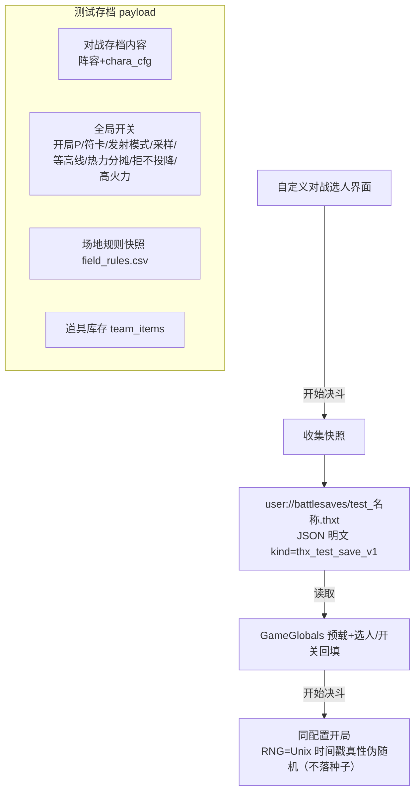
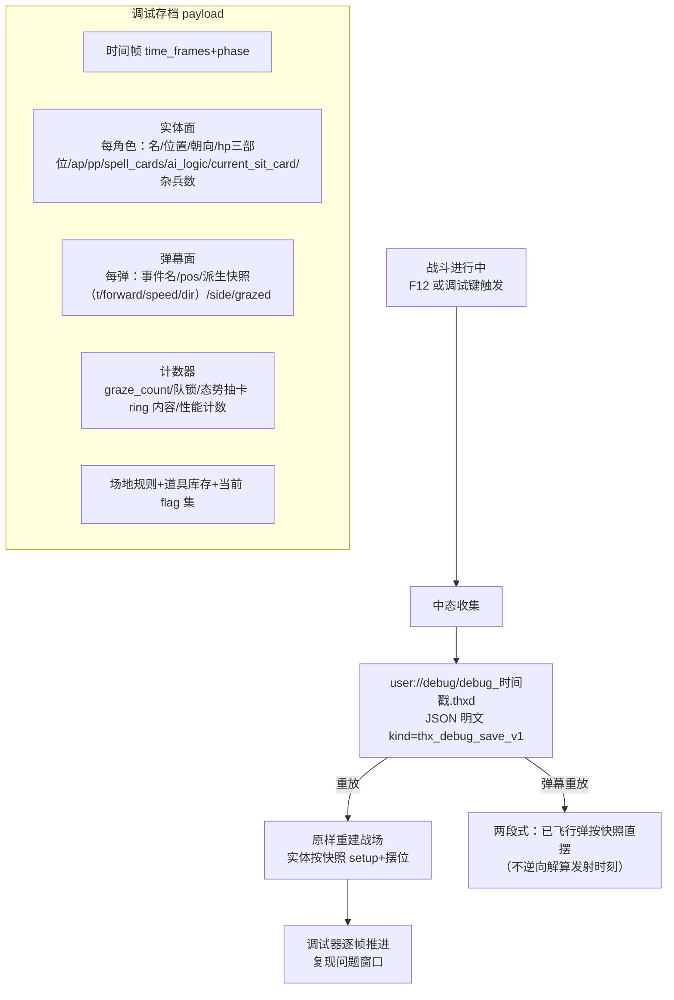
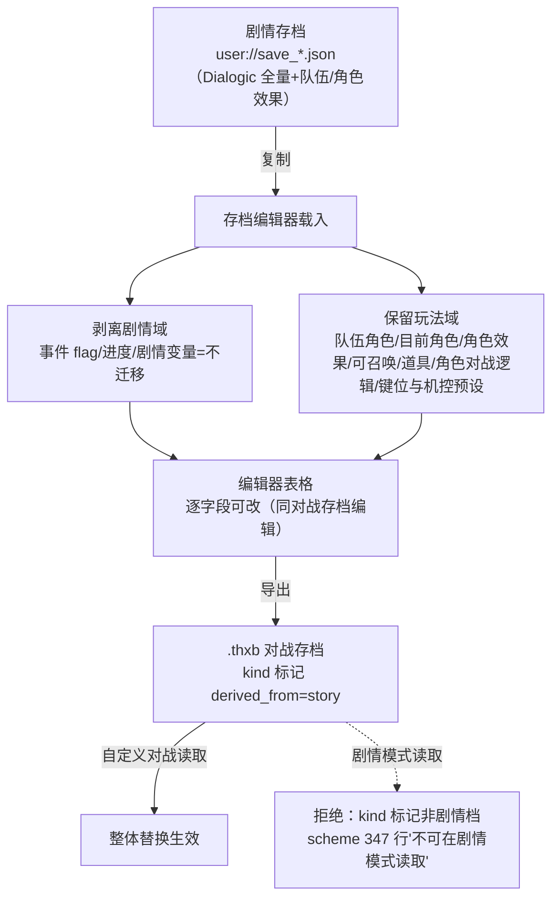

# 存档后续（测试存档/调试存档/存档编辑器）流程图原型 v2

> 作者裁定（m108→m109）：存档后续主要在代码上解析和分析，做流程图原型即可。
> **作者批复 v2（存档检查专案功能批复.md，20261121——主导权交 AI，只给目标与想法）**：
> 目标=开发者调试选项（"上上下下左右左右BABA"同理：关卡设计/剧情叠加/开发者难度/进度跳转）；
> **THX75 不存在存档种子**（体验统一化禁止——随机一律真性伪随机=精确到秒的系统 Unix 时间戳）；
> 剧情检查点=事件 flag 开关模拟状态（道具/元件本身就是开关），flag 按序号+优先级组叠加/覆盖/免除；
> 数值覆盖与加成好说，设计规则稳扎稳打——存档用到的规则=GameKit 已出现的规则，部分规则后续会改到插件里。

## 零、玩法结构基线（批复"理想剧情-对战链条"）
- RPG 为主、决斗为辅；新游戏开档三流程：**选人（3 队伍）× 角色 AB 配置（同贴图性格剧情链，弹幕表现/上手度区分）× 难度（Easy/Normal/Hard/Lunatic）= 12 种关卡配置链条**；
- 每链一串截然不同的数十个关卡（关卡总量上百但普遍短）——关卡与链条在游戏内写好、安排代码等剧情调用，**存档只告诉系统调用哪一串**；
- 未选的两支队伍扮演伪装玩家：纯随机算资源/全局进度积分（不靠拟真对战）；
- `gamedata.gd`（原生早期构思）未来=读档时被赋值的数据载体（角色膨胀数值/开新功能新技能）；
- 现状"敌方从自机队伍选"=demo 性质；日后敌方走 0.0.9 的片段/剪辑放华丽弹幕、自机队用现有风格回敬——自定义敌方/双人联机依赖剧情剪辑，走花映塚式双人街机方向而非对打蛐蛐。

## 一、开发者调试选项（批复目标=经典秘籍式）

要点：秘籍=开发期工具（玩家视角的作弊）——入口隐藏、不入正式 UI 流；全部走"flag 覆盖+数值覆写"一条管线。

## 二、flag 叠加架构（批复"检查点=开关模拟状态"）

要点：道具/元件本身就是 flag 开关；敌方不携带大量覆盖数据（对战不对等覆盖是常态）。

## 三、测试存档（对战配置快照——复现同局开局；**无种子版**）

**v2 修正**：原 v1 的"seed 固定 RNG 复现"废除——THX75 不存在存档种子（作者裁定）；测试存档复现=配置面复现（同阵容/逻辑/规则/道具），随机面按真性伪随机自然展开。探针内的确定性 seed 仅限测试台（不入游戏路径）。

## 四、调试存档（战场中态快照——问题时刻冻结）

## 五、存档编辑器（剧情存档复制→作用于自定义对战）

## 六、实装排期建议
| 件 | 依赖 | 量级 |
|---|---|---|
| 开发者调试面板（秘籍入口+flag 手动置位+数值注入） | flag 叠加管线 | 中 |
| 测试存档 | 对战存档✓ | 小（payload 组装+回填） |
| 调试存档 | 中态收集器（实体/弹幕快照函数） | 中（弹幕面逐字段） |
| flag 叠加管线 | gamedata.gd 重构（读档赋值数据载体） | 大（随剧情对接 0.2.0） |
| 存档编辑器 | 剧情档 schema 摸底（Dialogic 导出结构） | 中-大（随剧情对接批） |
