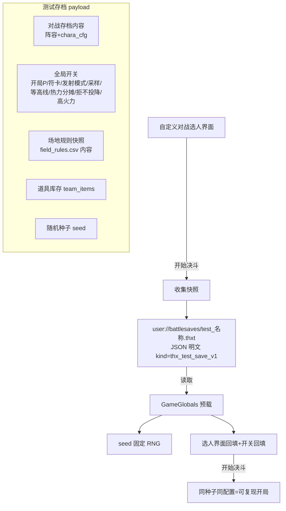
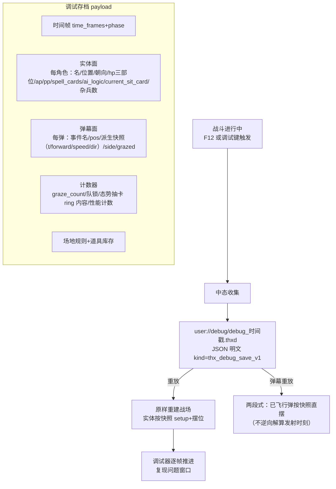
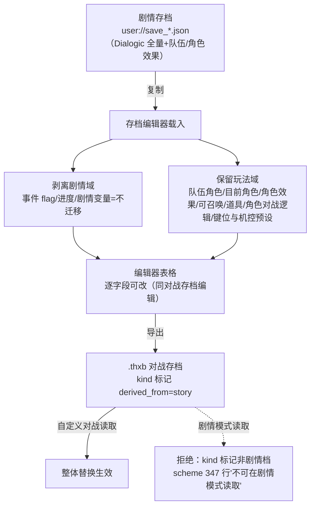

# 存档后续（测试存档/调试存档/存档编辑器）流程图原型

> 作者裁定（m108→m109）：存档后续主要在代码上解析和分析，做流程图原型即可。
> 本档=设计原型（mermaid 流程图+数据契约），实装随 0.0.9 收官排序或 0.2.0。

## 已交付基线（m101/m102）
- **对战存档 `.thxb`**：`user://battlesaves/*.thxb` JSON 明文（kind=thx_battle_save_v1）；
- 内容=player_team/enemy_team/chara_cfg 全量（角色逻辑/杂兵排布/资源 pp·spell；能力因素后续进 cfg 自动随档）；
- 读取=整体替换（斗蛐蛐复现口径）+分侧读取（all/player/enemy——逻辑跟着阵容走）+统一存档列表+系统资源浏览器导入导出。

## 一、测试存档（对战配置快照——一键复现同局开局）

要点：测试存档=对战存档的超集（配置面），不捕捉战场中态；复现依赖 seed 固定（SitCardSystem rng 已接全局 RNG 种子）。

## 二、调试存档（战场中态快照——问题时刻冻结）

要点：调试存档=观测冻结，不承诺逐弹位级回放（弹幕运动学由事件+快照变量驱动，直摆+续演=性能与精度的折中——作者"存档数据可能有失真"口径）。

## 三、存档编辑器（剧情存档复制→作用于自定义对战）

要点：编辑器=对战存档编辑界面（复用 m102 统一列表范式）+剧情档解析剥离层；剧情档→对战档单向（反向禁止）。

## 四、实装排期建议
| 件 | 依赖 | 量级 |
|---|---|---|
| 测试存档 | 对战存档✓+seed 固定 | 小（payload 组装+回填） |
| 调试存档 | 中态收集器（实体/弹幕快照函数） | 中（弹幕面逐字段） |
| 存档编辑器 | 剧情档 schema 摸底（Dialogic 导出结构）+表格 UI | 中-大（随剧情对接批） |
